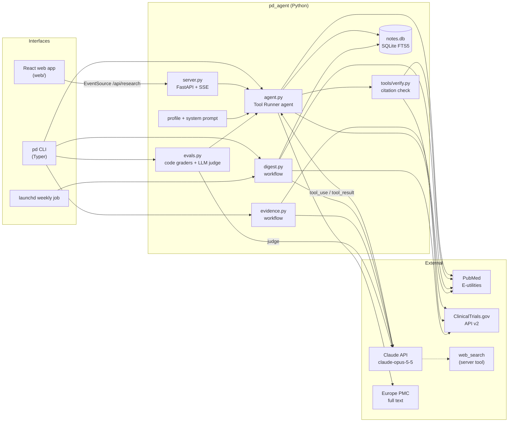

# Architecture

## Request lifecycle: `pd research "…"`
1. `agent.run()` builds the request: tools (8 client tools + web search), system prompt (rules → profile, in cache-friendly order), and the question with today's date.
2. The SDK **Tool Runner** loops: Claude asks for tools, `Session.track` runs them (budget, events, ID tracking), and the results go back, until Claude answers.
3. `verify.verify_citations()` looks up every `[PMID:…]` and `[NCT…]` at its source.
4. The answer, citation statuses and cost go to the CLI or web; the answer is saved to memory.

## Design decisions
| Decision | Why |
|---|---|
| Agent for open questions, **workflows** for the digest and evidence tables | Fixed steps are cheaper, faster and reproducible; the model does only the judgement step. |
| **Deterministic citation verification** after generation | Prompting alone doesn't stop invented references; code can't be talked out of a red X. |
| Keyword search (FTS5) for memory | Biomedical text is full of exact terms (gene names, IDs); no infrastructure needed. Embeddings are a documented extension. |
| Health data in git-ignored `data/`; demo profile for evals and public demo | Privacy by default; reproducible evals. |
| One `agent.run()` with an `on_event` callback | The CLI, web server and evals share the same core. |
| Retries in one HTTP helper; tool errors returned to the model | Public APIs fail transiently; the agent can recover instead of crashing. |
| Demo mode replays a recorded run | A portfolio link that costs nothing and can't be abused. |
| Prompt caching with volatile data (date) in the last message | ~95% cheaper repeated prefixes in multi-turn tool loops. |

## Testing strategy
- **Unit tests** (`tests/`, about 40, offline): tools against recorded real API responses (`respx`), the agent loops with fake models, the graders, and server endpoints in demo mode.
- **Evals** (`evals/`, 26 questions): real model; code graders, an LLM judge with a structured rubric, and a scorecard compared with the previous run.
- **Live tool checks** during development caught two silent data bugs (see Lesson 3).
